<div align="center">

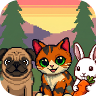

# Pixel Pet

**Cozy pixel-art pets that live on your Android home screen**

**English** · [Русский](README.ru.md)

[](#requirements)
[](#requirements)
[](#requirements)
[](LICENSE)
[](#features)

<a href="https://play.google.com/store/apps/details?id=com.aixdev.pixelpet">
  
</a>

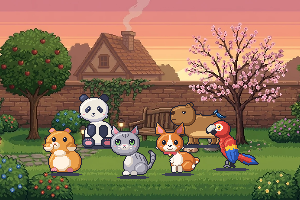

</div>

---

## Contents

- [Features](#features)
- [Meet the pets](#meet-the-pets)
- [Autumn backgrounds](#autumn-backgrounds)
- [Daily care](#daily-care)
- [How it works](#how-it-works)
- [Build from source](#build-from-source)
- [Project structure](#project-structure)
- [Requirements](#requirements)
- [Contributing](#contributing)
- [License](#license)

---

## Features

| | |
|---|---|
| 🐾 **10 pets** | Cat, pug, rabbit, panda, hamster, capybara, parrot, corgi puppy, grey kitten and a whole aquarium with three goldfish |
| 🌱 **They live on their own** | A tap wakes the pet up; for about a minute it walks, eats, plays and looks around by itself, then dozes off again |
| 🍂 **Living backgrounds** | Three animated autumn scenes, and every pet has its own little story with each of them |
| 💛 **Gentle care** | Food and mood, a daily gift, a streak, seasonal hats. Nothing bad ever happens: no sickness, no running away |
| 🎨 **One pixel look** | Pixel UI kit, the Tiny5 font, light and warm dark themes, soft chiptune sounds. The widget itself stays silent |
| 🔋 **Battery-friendly** | Frames are played by the launcher. The app wakes up only when the pet changes what it does, and not at all while every pet sleeps |
| 🌍 **Two languages** | English and Russian, switched in the settings |

---

## Meet the pets

<table>
  <tr>
    <td align="center">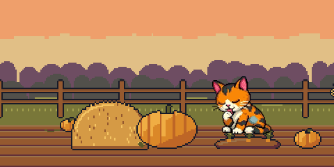<br><b>Cat</b><br><sub>Sweet and cuddly</sub></td>
    <td align="center">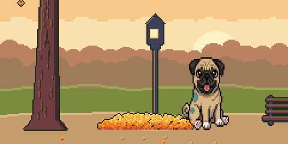<br><b>Pug</b><br><sub>Loyal and playful</sub></td>
    <td align="center">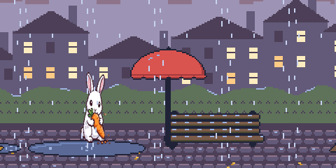<br><b>Rabbit</b><br><sub>Fluffy and cute</sub></td>
  </tr>
  <tr>
    <td align="center">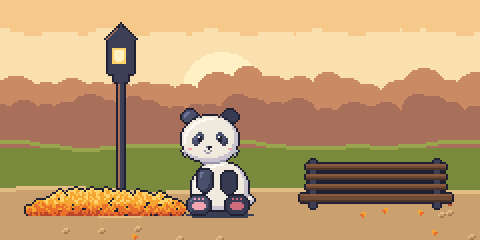<br><b>Panda</b><br><sub>Big, sleepy and chill</sub></td>
    <td align="center">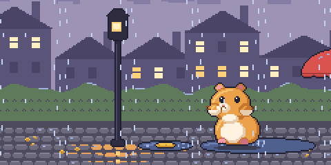<br><b>Hamster</b><br><sub>Tiny, quick and thrifty</sub></td>
    <td align="center">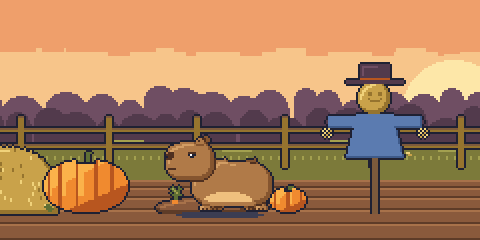<br><b>Capybara</b><br><sub>Big, slow and friendly</sub></td>
  </tr>
  <tr>
    <td align="center">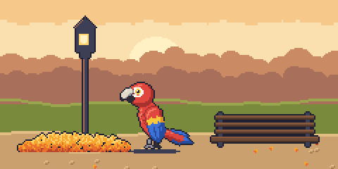<br><b>Parrot</b><br><sub>Bright and chatty, flies</sub></td>
    <td align="center">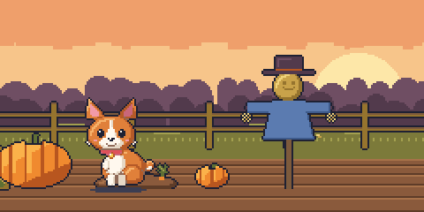<br><b>Puppy</b><br><sub>A corgi that runs about</sub></td>
    <td align="center">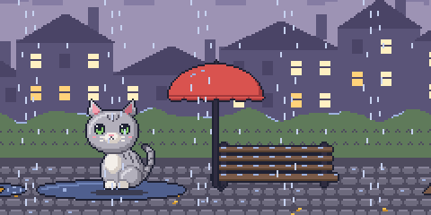<br><b>Kitten</b><br><sub>The smallest, loves yarn</sub></td>
  </tr>
  <tr>
    <td align="center" colspan="3">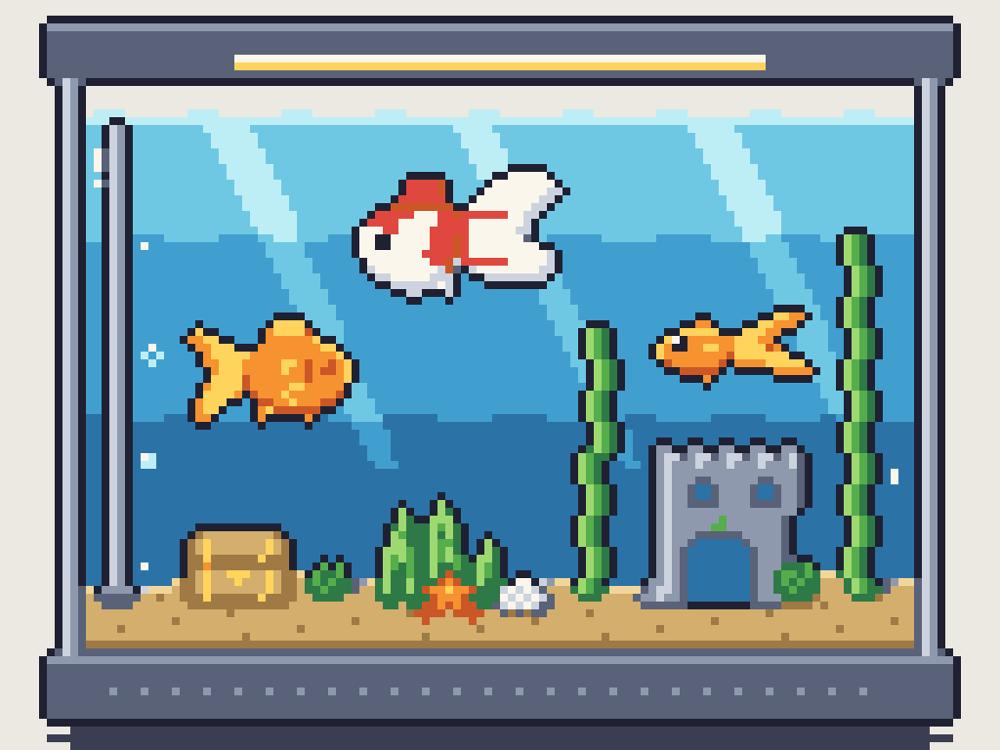<br><b>Aquarium</b><br><sub>A whole scene: lamp, plants, castle, treasure chest and three goldfish</sub></td>
  </tr>
</table>

| Pet | What it does |
|---|---|
| Cat | Sleep · Lick · Sit · Walk |
| Pug | Sleep · Mouth open · Sit · Walk |
| Rabbit | Sleep · Eat · Walk |
| Panda | Sleep · Happy · Idle · Eat bamboo · Roll · Walk |
| Hamster | Sleep · Happy · Idle · Eat a seed · Stuff cheeks · Scurry |
| Capybara | Sleep · Happy · Idle · Chew grass · Warm bath with an orange · Stroll |
| Parrot | Sleep · Flap wings · Idle · Eat a seed · Chatter · Hop · Fly |
| Puppy | Sleep · Jump for joy · Idle · Chew a bone · Chase its tail · Trot |
| Kitten | Sleep · Hop and purr · Idle · Lap milk · Play with yarn · Walk |
| Aquarium | Sleep (lamp off) · Joy · Idle · Feeding flakes · Treasure chest · Swim |

The cat, the pug and the rabbit are hand-drawn. The other pets are true 64×64 pixel art and the
aquarium a 128×96 scene, all drawn in code by [`tools/sprite_gen`](tools/sprite_gen/README.md) and
scaled by whole numbers only, so every pixel stays crisp. Their character shows in size and speed:
the panda and the capybara are big and slow, the hamster is tiny and quick, the puppy runs about,
the kitten mostly sits, washes and plays.

---

## Autumn backgrounds

<table>
  <tr>
    <td align="center">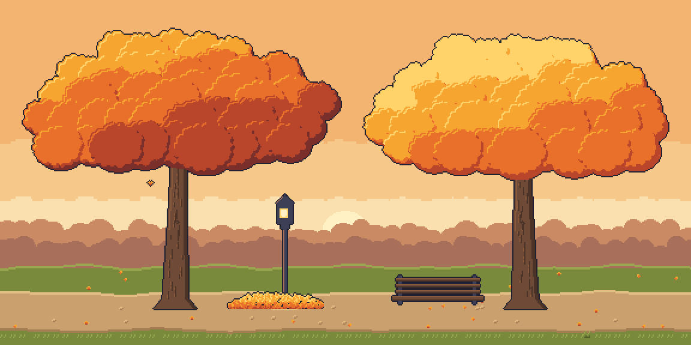<br><b>Maple park</b><br><sub>Falling leaves, a lamp, a bench</sub></td>
    <td align="center">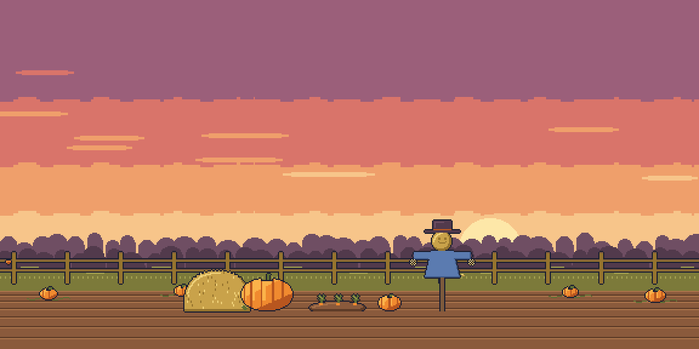<br><b>Pumpkin field</b><br><sub>Pumpkins, hay and a scarecrow</sub></td>
    <td align="center">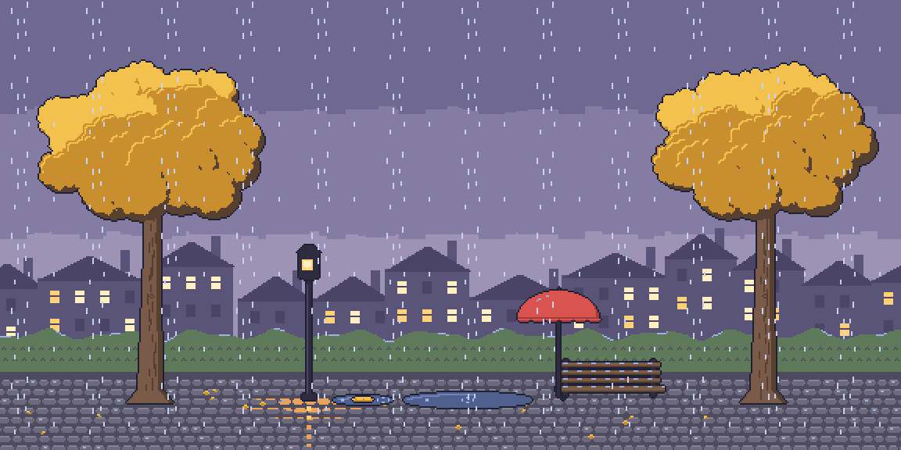<br><b>Rainy evening</b><br><sub>Rain, puddles, a red umbrella</sub></td>
  </tr>
</table>

While a pet is awake on one of these scenes, now and then it notices something there and plays
with it: it chases a falling leaf, hugs a pumpkin, hides under the umbrella. Every pet has its own
interaction with every background. Besides the autumn scenes there are three painted backgrounds,
and each widget keeps its own.

---

## Daily care

| | |
|---|---|
| 🍖 **Food and mood** | Slowly drop over the day. A hungry pet shows a thought bubble with its favourite food, a lonely one shows a heart; tap the bubble to open the app on that pet |
| 🤲 **Feed and stroke** | Feeding costs one treat. Stroke the pet in the app's preview; taps on the widget count as play |
| 🎁 **Daily gift** | Treats once a day, bonuses for a streak, a streak freeze for every full week and a bow after the first one |
| 🎩 **Wardrobe** | Bow, Halloween hat (15 Oct – 10 Nov) and Santa hat (15 Dec – 10 Jan) for the pixel-art pets. Seasonal decorations appear on every widget during those dates |
| 🌙 **Night mode** | From 22:00 to 7:00 the widget dims and the pets go to sleep |
| 🔔 **Reminder** | Optional, at 19:00, and only when a gift or a hungry pet is waiting |

---

## How it works

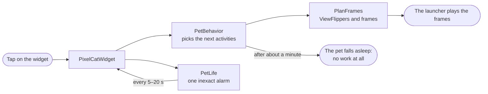

- **No code runs per frame.** The widget is built from `ViewFlipper`s inside `RemoteViews`, so the
  launcher animates the pet by itself. The app runs only when the pet changes activity.
- **One alarm for all pets.** `PetLife` sets a single ordinary inexact alarm for the next change:
  no exact-alarm permission, no foreground service, no wake locks.
- **A plan per update.** `PetBehavior` plans one or two activities at a time, `PlanFrames` turns
  the plan into a tree of flippers. Pixel pets walk whole art pixels per frame in step with their
  paws and never jump back, even if the next alarm comes late.
- **Reproducible lives.** Each widget stores only a small session; random choices come from its
  own seed, so the same seed always gives the same life.
- **Care without background work.** Food and mood are stored as the moment they were full, so the
  current level follows from the clock alone.
- **After a reboot** `RestartReceiver` puts every pet to sleep and sets the care alarms again.

---

## Build from source

```bash
git clone https://github.com/ars6nlp/PixelPetWidget.git
cd PixelPetWidget
./gradlew assembleDebug        # app/build/outputs/apk/debug/app-debug.apk
./gradlew testDebugUnitTest    # unit tests
```

Or open the folder in Android Studio and press **Run**.

<details>
<summary><b>Signed release build</b></summary>

Copy `keystore.properties.example` to `keystore.properties` (it is ignored by git) and fill in your
own keystore, or set `PIXELPET_STORE_FILE`, `PIXELPET_STORE_PASSWORD`, `PIXELPET_KEY_ALIAS` and
`PIXELPET_KEY_PASSWORD`. Without them `./gradlew bundleRelease` still builds, but unsigned.

</details>

<details>
<summary><b>Testing seasons and night on a debug build</b></summary>

Debug builds read two overrides (release builds ignore them):

```bash
adb shell am force-stop com.aixdev.pixelpet
adb shell run-as com.aixdev.pixelpet sh -c "cat > shared_prefs/PixelPetSettings.xml" <<'EOF'
<?xml version='1.0' encoding='utf-8' standalone='yes' ?>
<map>
    <string name="debug_season">halloween</string>  <!-- halloween, winter or empty -->
    <string name="debug_night">true</string>
</map>
EOF
adb shell am broadcast -n com.aixdev.pixelpet/com.example.pixelpetwidget.PixelCatWidget -a com.example.pixelpetwidget.CARE_TICK
```

</details>

---

## Project structure

```text
app/src/main/java/com/example/pixelpetwidget/
├── PixelCatWidget.java       the widget: turns a pet's plan into RemoteViews
├── PetSpec.java              each pet's animations, speed, size and activities
├── PetBehavior.java          a pet's own life after a tap
├── PlanFrames.java           the plan as a tree of ViewFlippers and frames
├── PetLife.java              one alarm for all awake pets
├── FlightPath.java           the parrot's flight over the widget
├── Backdrop.java             the autumn scenes behind the pet
├── BackgroundEvents.java     what each pet does with each background
├── PetCare.java              food and mood
├── DailyRewards.java         daily gift and streak
├── Wardrobe.java             bow and seasonal hats
├── MainActivitySimple.java   the app's single screen
├── ui/                       Pixel UI kit and theme (see DESIGN.md)
└── sound/                    sounds for buttons and pet voices
tools/sprite_gen/             Python generator of the pixel pets and backgrounds
tools/sound_gen/              Python generator of the chiptune sounds
tools/font/                   preparation of the Tiny5 font
art-source/                   source art of the hand-drawn pets
```

How the app screens are built and how to change them: [`DESIGN.md`](DESIGN.md).

---

## Requirements

| | |
|---|---|
| Minimum Android | 7.0 (API 24) |
| Target and compile SDK | 36 (Android 16) |
| Language | Java 11 |
| Build | Gradle wrapper included, Android Studio |

---

## Contributing

Ideas and pull requests are welcome: new pets, new backgrounds and interactions, translations.

1. Fork the repository
2. Create a branch: `git checkout -b feature/my-pet`
3. Commit your changes and push the branch
4. Open a pull request

A new pet is one entry in `PetSpec.forType`; a new background is drawn in `tools/sprite_gen`,
gets a `bg_type` in `Backdrop` and one row per pet in `BackgroundEvents`.

---

## License

The source code is licensed under the [MIT License](LICENSE).

The sounds and the graphics (pet sprites, backgrounds, icons and other artwork under
`app/src/main/res`, `art-source` and `tools/sprite_gen/output`) may be protected separately: all
rights reserved unless a file says otherwise. The font Tiny5 keeps its own licence
(SIL OFL 1.1, see [`licenses/Tiny5-OFL.txt`](licenses/Tiny5-OFL.txt)).

---

<div align="center">

Made by [**ars6nlp**](https://github.com/ars6nlp)

If you like the pets, give the repo a ⭐

</div>
