<div align="center">

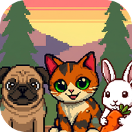

# Pixel Pet

**Уютные пиксельные питомцы, которые живут на главном экране Android**

[English](README.md) · **Русский**

[](#требования)
[](#требования)
[](#требования)
[](LICENSE)
[](#возможности)

<a href="https://play.google.com/store/apps/details?id=com.aixdev.pixelpet">
  
</a>

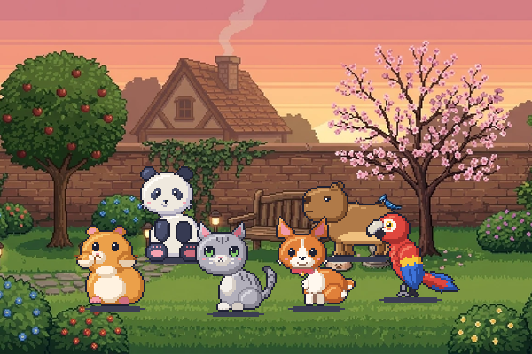

</div>

---

## Содержание

- [Возможности](#возможности)
- [Питомцы](#питомцы)
- [Осенние фоны](#осенние-фоны)
- [Забота о питомце](#забота-о-питомце)
- [Как это работает](#как-это-работает)
- [Сборка из исходников](#сборка-из-исходников)
- [Структура проекта](#структура-проекта)
- [Требования](#требования)
- [Участие в проекте](#участие-в-проекте)
- [Лицензия](#лицензия)

---

## Возможности

| | |
|---|---|
| 🐾 **10 питомцев** | Кошка, мопс, кролик, панда, хомяк, капибара, попугай, щенок корги, серый котёнок и целый аквариум с тремя золотыми рыбками |
| 🌱 **Живут сами по себе** | Нажатие будит питомца; около минуты он сам гуляет, ест, играет и осматривается, а потом снова засыпает |
| 🍂 **Живые фоны** | Три анимированные осенние сцены, и у каждого питомца своя маленькая история с каждой из них |
| 💛 **Мягкая забота** | Сытость и настроение, ежедневный подарок, серия дней, сезонные шапки. Ничего плохого не случается: питомцы не болеют и не убегают |
| 🎨 **Единый пиксельный стиль** | Свой набор пиксельных компонентов, шрифт Tiny5, светлая и тёплая тёмная темы, мягкие чиптюн-звуки. Сам виджет молчит |
| 🔋 **Бережёт батарею** | Кадры проигрывает лаунчер. Приложение просыпается, только когда питомец меняет занятие, и не работает вовсе, пока все питомцы спят |
| 🌍 **Два языка** | Английский и русский, переключаются в настройках |

---

## Питомцы

<table>
  <tr>
    <td align="center">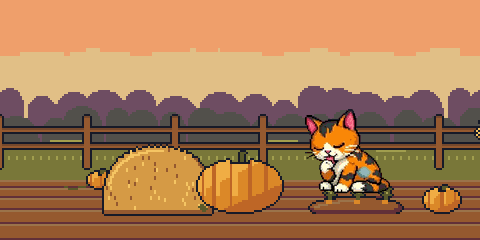<br><b>Кошка</b><br><sub>Милая и ласковая</sub></td>
    <td align="center">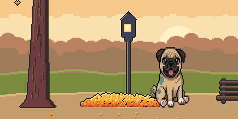<br><b>Мопс</b><br><sub>Верный и игривый</sub></td>
    <td align="center">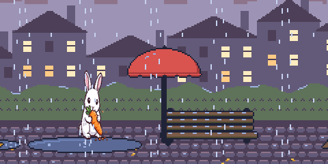<br><b>Кролик</b><br><sub>Пушистый и милый</sub></td>
  </tr>
  <tr>
    <td align="center">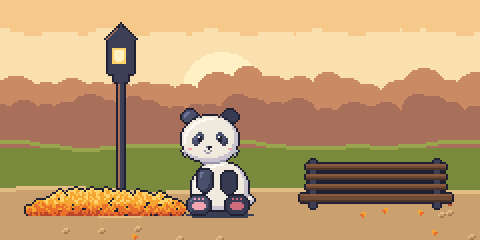<br><b>Панда</b><br><sub>Большая, сонная и спокойная</sub></td>
    <td align="center">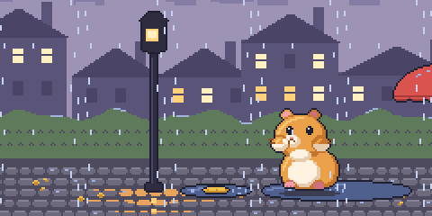<br><b>Хомяк</b><br><sub>Маленький, шустрый и запасливый</sub></td>
    <td align="center">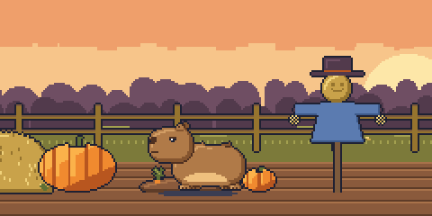<br><b>Капибара</b><br><sub>Большая, неспешная и дружелюбная</sub></td>
  </tr>
  <tr>
    <td align="center">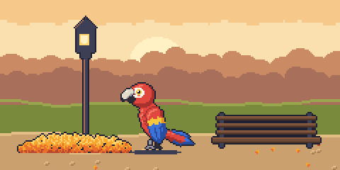<br><b>Попугай</b><br><sub>Яркий и болтливый, летает</sub></td>
    <td align="center">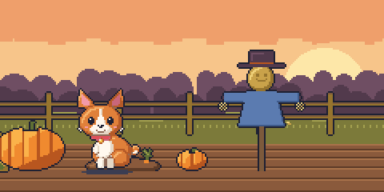<br><b>Щенок</b><br><sub>Корги, который носится туда-сюда</sub></td>
    <td align="center">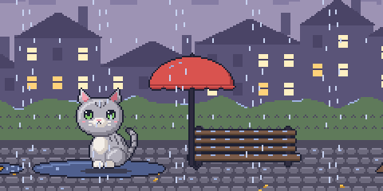<br><b>Котёнок</b><br><sub>Самый маленький, обожает клубок</sub></td>
  </tr>
  <tr>
    <td align="center" colspan="3">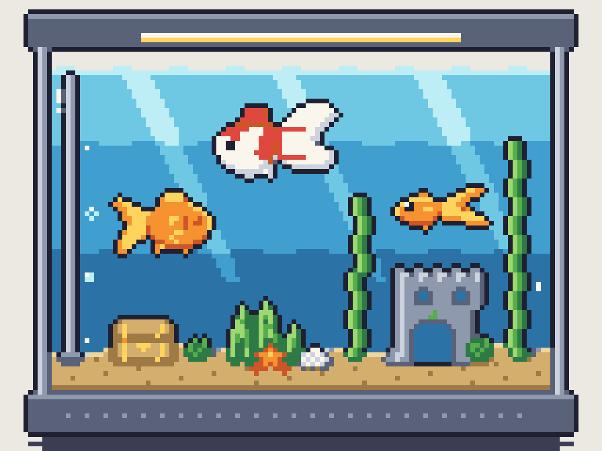<br><b>Аквариум</b><br><sub>Целая сцена: лампа, растения, замок, сундук с сокровищами и три золотые рыбки</sub></td>
  </tr>
</table>

| Питомец | Что делает |
|---|---|
| Кошка | Спит · Умывается · Сидит · Гуляет |
| Мопс | Спит · Открывает пасть · Сидит · Гуляет |
| Кролик | Спит · Ест · Гуляет |
| Панда | Спит · Радуется · Отдыхает · Ест бамбук · Кувыркается · Гуляет |
| Хомяк | Спит · Радуется · Отдыхает · Грызёт семечку · Набивает щёки · Бегает |
| Капибара | Спит · Радуется · Отдыхает · Жуёт траву · Греется в ванне с апельсином · Прогуливается |
| Попугай | Спит · Машет крыльями · Отдыхает · Ест семечку · Болтает · Прыгает · Летает |
| Щенок | Спит · Прыгает от радости · Отдыхает · Грызёт косточку · Ловит свой хвост · Бегает рысцой |
| Котёнок | Спит · Подпрыгивает и мурлычет · Отдыхает · Лакает молоко · Играет с клубком · Гуляет |
| Аквариум | Спит (лампа выключена) · Радуется · Отдыхает · Кормление · Сундук с сокровищами · Плавает |

Кошка, мопс и кролик нарисованы вручную. Остальные питомцы — настоящий пиксель-арт 64×64, а
аквариум — сцена 128×96. Всё это рисуется кодом в [`tools/sprite_gen`](tools/sprite_gen/README.md)
и масштабируется только в целое число раз, поэтому каждый пиксель остаётся чётким. Характер видно
по размеру и скорости: панда и капибара большие и неспешные, хомяк крошечный и быстрый, щенок
носится туда-сюда, котёнок в основном сидит, умывается и играет.

---

## Осенние фоны

<table>
  <tr>
    <td align="center">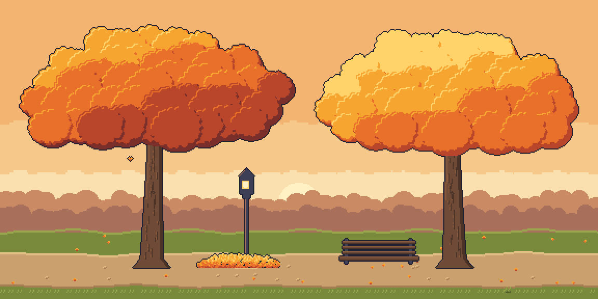<br><b>Кленовый парк</b><br><sub>Падающие листья, фонарь, скамейка</sub></td>
    <td align="center">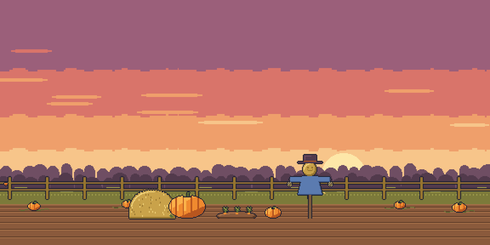<br><b>Тыквенное поле</b><br><sub>Тыквы, сено и пугало</sub></td>
    <td align="center">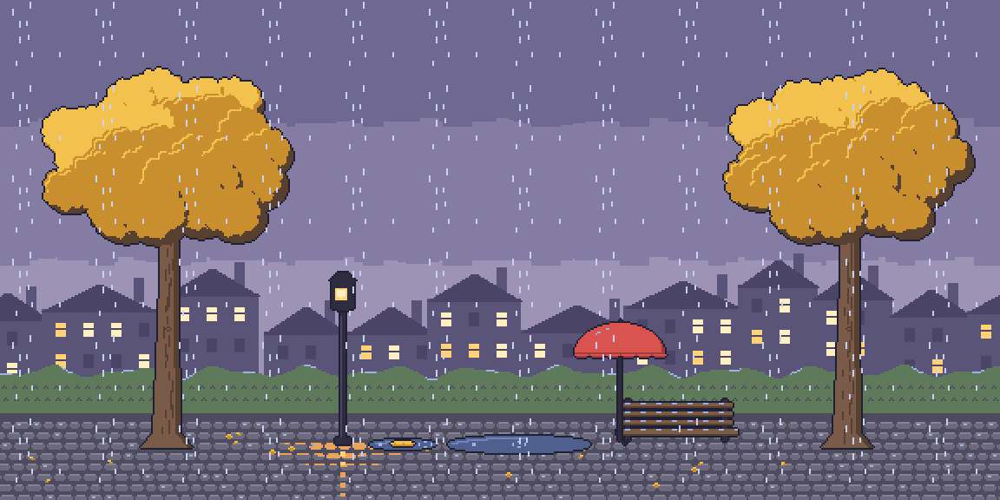<br><b>Дождливый вечер</b><br><sub>Дождь, лужи, красный зонт</sub></td>
  </tr>
</table>

Пока питомец не спит на одной из этих сцен, время от времени он что-то замечает и играет с этим:
ловит падающий лист, обнимает тыкву, прячется под зонтом. У каждого питомца своё занятие на
каждом фоне. Кроме осенних сцен есть ещё три рисованных фона, и у каждого виджета фон свой.

---

## Забота о питомце

| | |
|---|---|
| 🍖 **Сытость и настроение** | Понемногу снижаются за день. Голодный питомец показывает облачко с любимой едой, заскучавший — сердечко; нажмите на облачко, и приложение откроется на этом питомце |
| 🤲 **Покормить и погладить** | Кормление стоит одно лакомство. Погладить питомца можно в превью в приложении, а нажатия на виджет считаются игрой |
| 🎁 **Ежедневный подарок** | Лакомства раз в день, бонусы за серию дней, заморозка серии за каждую полную неделю и бантик после первой |
| 🎩 **Гардероб** | Бантик, шляпа на Хэллоуин (15 окт. – 10 нояб.) и шапка Деда Мороза (15 дек. – 10 янв.) для пиксельных питомцев. В эти даты на всех виджетах появляются сезонные украшения |
| 🌙 **Ночной режим** | С 22:00 до 7:00 виджет темнеет, а питомцы засыпают |
| 🔔 **Напоминание** | По желанию, в 19:00, и только если ждёт подарок или голодный питомец |

---

## Как это работает

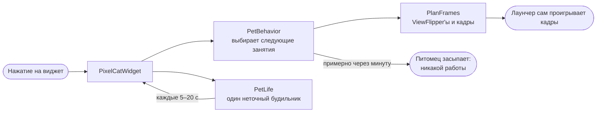

- **Никакого кода на каждый кадр.** Виджет собран из `ViewFlipper` внутри `RemoteViews`, поэтому
  питомца анимирует сам лаунчер. Приложение работает, только когда питомец меняет занятие.
- **Один будильник на всех.** `PetLife` ставит один обычный неточный будильник на следующую смену
  занятия: без разрешения на точные будильники, без foreground-сервиса и без wake lock.
- **План на каждое обновление.** `PetBehavior` планирует одно-два занятия за раз, `PlanFrames`
  превращает план в дерево флипперов. Пиксельные питомцы шагают ровно на целые пиксели рисунка
  в такт лапам и никогда не «прыгают» назад, даже если следующий будильник опоздал.
- **Воспроизводимая жизнь.** Каждый виджет хранит только небольшую сессию; случайные выборы идут
  от её собственного seed, так что один и тот же seed всегда даёт одну и ту же жизнь.
- **Забота без фоновой работы.** Сытость и настроение хранятся как момент, когда они были полными,
  поэтому текущий уровень вычисляется просто по часам.
- **После перезагрузки** `RestartReceiver` укладывает всех питомцев спать и заново ставит будильники.

---

## Сборка из исходников

```bash
git clone https://github.com/ars6nlp/PixelPetWidget.git
cd PixelPetWidget
./gradlew assembleDebug        # app/build/outputs/apk/debug/app-debug.apk
./gradlew testDebugUnitTest    # юнит-тесты
```

Или откройте папку в Android Studio и нажмите **Run**.

<details>
<summary><b>Подписанная релизная сборка</b></summary>

Скопируйте `keystore.properties.example` в `keystore.properties` (git его не видит) и впишите
данные своего keystore, либо задайте переменные `PIXELPET_STORE_FILE`, `PIXELPET_STORE_PASSWORD`,
`PIXELPET_KEY_ALIAS` и `PIXELPET_KEY_PASSWORD`. Без них `./gradlew bundleRelease` тоже соберётся,
но без подписи.

</details>

<details>
<summary><b>Проверка сезонов и ночи на debug-сборке</b></summary>

Debug-сборки читают две настройки для проверки (релизные их игнорируют):

```bash
adb shell am force-stop com.aixdev.pixelpet
adb shell run-as com.aixdev.pixelpet sh -c "cat > shared_prefs/PixelPetSettings.xml" <<'EOF'
<?xml version='1.0' encoding='utf-8' standalone='yes' ?>
<map>
    <string name="debug_season">halloween</string>  <!-- halloween, winter или пусто -->
    <string name="debug_night">true</string>
</map>
EOF
adb shell am broadcast -n com.aixdev.pixelpet/com.example.pixelpetwidget.PixelCatWidget -a com.example.pixelpetwidget.CARE_TICK
```

</details>

---

## Структура проекта

```text
app/src/main/java/com/example/pixelpetwidget/
├── PixelCatWidget.java       виджет: превращает план питомца в RemoteViews
├── PetSpec.java              анимации, скорость, размер и занятия каждого питомца
├── PetBehavior.java          собственная жизнь питомца после нажатия
├── PlanFrames.java           план в виде дерева ViewFlipper'ов и кадров
├── PetLife.java              один будильник для всех неспящих питомцев
├── FlightPath.java           полёт попугая над виджетом
├── Backdrop.java             осенние сцены за питомцем
├── BackgroundEvents.java     что каждый питомец делает на каждом фоне
├── PetCare.java              сытость и настроение
├── DailyRewards.java         ежедневный подарок и серия дней
├── Wardrobe.java             бантик и сезонные шапки
├── MainActivitySimple.java   единственный экран приложения
├── ui/                       пиксельные компоненты и тема (см. DESIGN.md)
└── sound/                    звуки кнопок и голоса питомцев
tools/sprite_gen/             генератор пиксельных питомцев и фонов на Python
tools/sound_gen/              генератор чиптюн-звуков на Python
tools/font/                   подготовка шрифта Tiny5
art-source/                   исходники рисованных питомцев
```

Как устроены экраны приложения и как их менять: [`DESIGN.md`](DESIGN.md).

---

## Требования

| | |
|---|---|
| Минимальный Android | 7.0 (API 24) |
| Target и compile SDK | 36 (Android 16) |
| Язык | Java 11 |
| Сборка | Gradle wrapper в комплекте, Android Studio |

---

## Участие в проекте

Идеи и pull request'ы приветствуются: новые питомцы, новые фоны и занятия на них, переводы.

1. Сделайте fork репозитория
2. Создайте ветку: `git checkout -b feature/my-pet`
3. Закоммитьте изменения и отправьте ветку
4. Откройте pull request

Новый питомец — это одна запись в `PetSpec.forType`; новый фон рисуется в `tools/sprite_gen`,
получает `bg_type` в `Backdrop` и по одной строке на каждого питомца в `BackgroundEvents`.

---

## Лицензия

Исходный код распространяется по [лицензии MIT](LICENSE).

Звуки и графика (спрайты питомцев, фоны, иконки и другие рисунки в `app/src/main/res`,
`art-source` и `tools/sprite_gen/output`) могут охраняться отдельно: все права защищены, если в
файле не сказано иное. У шрифта Tiny5 своя лицензия (SIL OFL 1.1, см.
[`licenses/Tiny5-OFL.txt`](licenses/Tiny5-OFL.txt)).

---

<div align="center">

Автор — [**ars6nlp**](https://github.com/ars6nlp)

Если питомцы понравились, поставьте репозиторию ⭐

</div>
